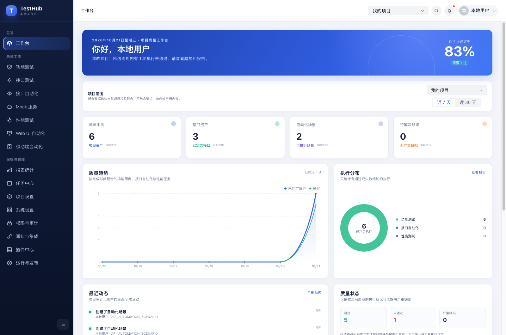
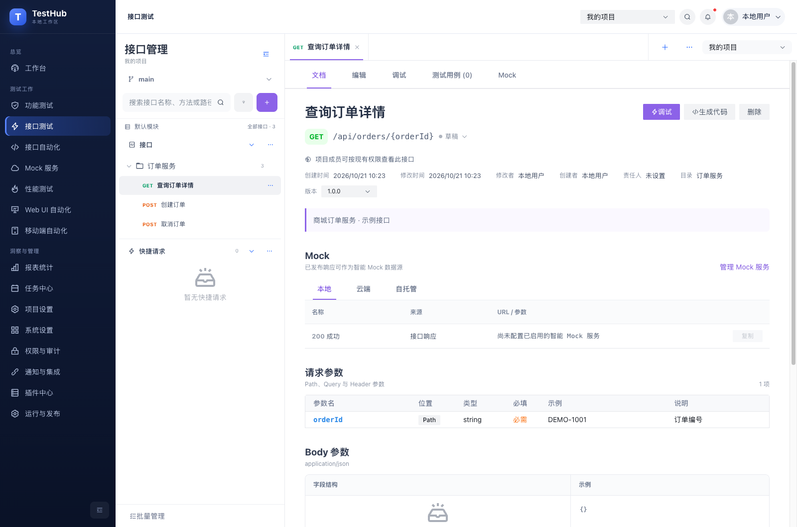
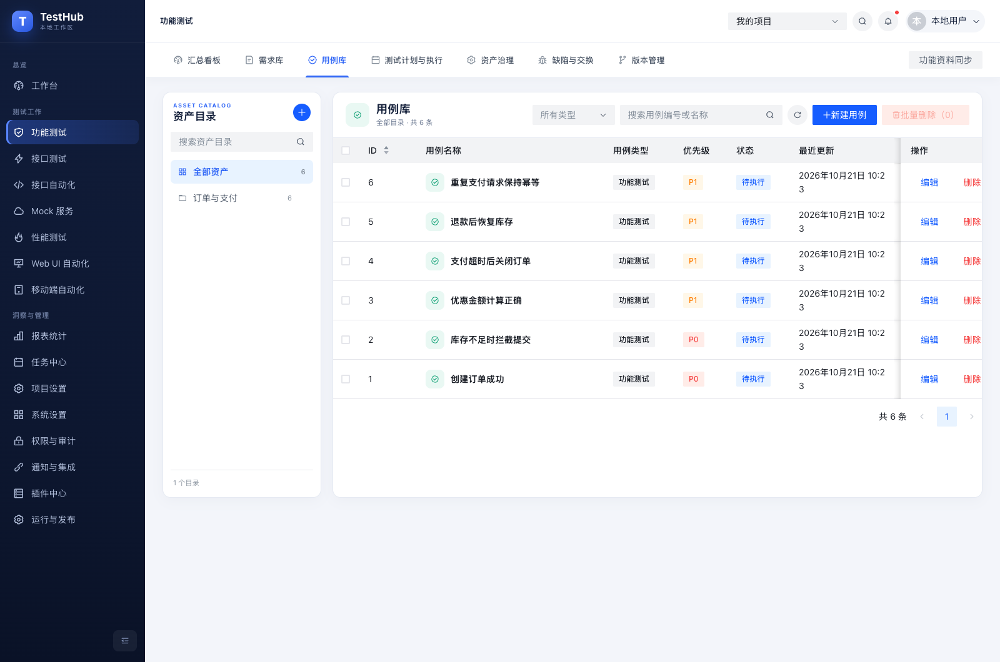

<div align="center">
  
  <h1>TestHub</h1>
  <p><strong>从用例到执行，从接口到质量报告。</strong></p>
  <p>本地即可工作的测试开发平台，也能连接你自己的团队服务。</p>
  <p><strong><a href="https://github.com/MrLimingbo/TestHub/releases/download/mac-v0.2.0-preview.20261021/TestHub-macOS-arm64-preview.dmg">下载 Mac Apple Silicon 预览版</a></strong><br /><sub>未签名（无 Developer ID） · 未公证 · arm64</sub></p>
  <p>
    <a href="#开始使用">开始使用</a> ·
    <a href="#功能一览">功能一览</a> ·
    <a href="#界面预览">界面预览</a> ·
    <a href="#开发与验证">开发与验证</a> ·
    <a href="#文档导航">文档导航</a>
  </p>
  <p>
    
    
    
    
  </p>
</div>

TestHub 将功能测试、接口设计与调试、Mock、自动化执行、性能测试和质量报告放在同一个项目工作区中。个人可以从本地桌面工作区开始，团队可以部署自己的 Web 服务；需要协作时，再连接账号并明确选择迁移或同步的内容。

- **先开始测试。** 桌面端首次使用无需注册，内置本地后端与运行时，无需另装 Java、Node.js、数据库或 Docker。
- **让测试过程连起来。** 管理需求与用例，执行接口、浏览器和性能任务，集中追踪结果与报告产物。
- **按需连接团队。** 支持注册、登录及桌面／网页端同账号访问；本地资料通过显式项目绑定与账号工作区同步。
- **让数据有归属。** 本地工作区、账号工作区及项目权限分别管理，提供加密备份、恢复和升级保护。

> **当前交付状态（2026-10-21）：** Mac Apple Silicon 桌面预览包已完成安装、升级与后台功能回归，并提供 [GitHub Release 下载](https://github.com/MrLimingbo/TestHub/releases/tag/mac-v0.2.0-preview.20261021)。该版本未签名、未公证；其他平台及正式签名发行的状态见[验收范围](#验收范围)。

## 界面预览

下图来自真实 TestHub 桌面程序，使用独立创建的商城示例数据。界面中的数量与结果仅用于展示，不代表性能基准。

**工作台：在一个入口查看项目资产、质量趋势与执行分布。**



<details>
<summary><strong>接口工作台</strong> — 目录、接口定义、版本与请求参数</summary>



</details>

<details>
<summary><strong>功能测试</strong> — 用例目录、优先级与执行准备</summary>



</details>

## 功能一览

| 模块 | 可以做什么 |
| --- | --- |
| **功能测试** | 管理需求、用例、测试计划、执行批次、缺陷和项目版本；维护标签、自定义字段及资产关联 |
| **接口测试** | 设计接口与历史版本，调试 HTTP、GraphQL、SOAP、WebSocket、gRPC；导入 OpenAPI、Postman、HAR 与 cURL，保存调试历史和重放草稿 |
| **接口自动化** | 编排请求、提取、断言、条件、循环与并行步骤；复用公共步骤、子场景和数据集，支持计划、Webhook 与 CLI 触发 |
| **Mock 服务** | 创建服务和匹配规则，定义响应、访问分享入口，辅助接口联调 |
| **性能测试** | 配置 JMeter 线程组、负载、断言与阈值；执行压测，查看指标、JTL 与日志产物 |
| **Web UI 自动化** | 管理浏览器配置、页面对象和场景步骤；通过 Playwright 执行，查看报告、截图、视频与 Trace |
| **移动端自动化** | 管理设备能力、应用文件、元素和场景，对接 Appium Runner；支持执行历史与报告产物同步，真实设备验收状态见下文 |
| **质量与任务** | 汇总各测试模块的真实执行记录，按项目查看质量统计、生成报告，并配置报告计划 |
| **协作与管理** | 组织／项目权限、成员、环境与参数、项目文件、审计记录；通知模板及受控插件／适配器配置 |
| **桌面数据管理** | 本地加密备份、恢复、升级保护，以及已支持资产、配置和历史的迁移与持续同步 |

浏览器引擎与 JMeter 在需要执行对应任务时下载或准备。Appium、设备驱动、SDK 和真实设备仍需要按移动端环境要求配置。

## 本地与团队协作

| 使用方式 | 数据与执行位置 | 需要准备 |
| --- | --- | --- |
| **桌面本地工作区** | 当前电脑；H2 数据库、本地文件与独立 Runner 进程 | TestHub 桌面预览包；外部执行组件按需准备 |
| **浏览器访问团队服务** | 部署方的 Platform API、存储及 Runner 环境 | 自行部署的 Web 服务；MySQL、Redis、MinIO |
| **桌面连接账号服务** | 账号数据保存在所连接的服务，本地工作区仍独立保留 | 服务地址与账号；需要同步时确认项目及资料范围 |

桌面安装包不预置维护者的服务地址或账号。离线时可以继续管理本地资料；访问目标接口、首次下载执行组件和账号同步需要相应网络。

桌面端的 HTTP、GraphQL 和 SOAP 调试可从当前电脑直接访问已授权的本机或内网目标。目标授权与项目环境密钥的处理边界见[桌面网络说明](docs/desktop-packaging.md#内网接口调试)。

### 同步如何工作

1. 在桌面端连接自己的账号服务并登录。
2. 选择两端项目，预览待同步内容；涉及成员、执行批次或跨项目范围时明确确认对应关系。
3. 建立相应模块的同步绑定。支持双向编辑的资料持续同步，断网后的待同步操作在连接恢复后继续处理。
4. 遇到双端修改、引用缺失或身份变化时暂停相关内容，由用户核对；恢复工作区备份后需要重新确认绑定。

同步覆盖已实现的功能资产、接口资料、自动化配置、项目文件、执行历史／报告产物和质量报告计划等范围。不同数据使用不同规则：Runner 生成的执行报告按只读历史保留，调试重放草稿只同步脱敏模板；敏感凭据不自动复制。接口自动化的计划／Webhook 和质量报告计划在同步创建或更新目标配置后保持停用，核对后再启用；已同步文件被单端删除时暂停核对。

详细边界与逐模块记录见[桌面改造与同步范围](docs/desktop-standalone-migration-plan.md)。

## 开始使用

### 桌面预览版

**Mac Apple Silicon（M 系列，arm64）· 0.2.0 预览版 · 2026-10-21 发布**

[下载 DMG 安装包](https://github.com/MrLimingbo/TestHub/releases/download/mac-v0.2.0-preview.20261021/TestHub-macOS-arm64-preview.dmg) · [版本说明与验收信息](https://github.com/MrLimingbo/TestHub/releases/tag/mac-v0.2.0-preview.20261021) · [SHA-256 校验文件](https://github.com/MrLimingbo/TestHub/releases/download/mac-v0.2.0-preview.20261021/SHA256SUMS.txt)

**这是未签名、未公证的预览版。** 未使用 Apple Developer ID 发行者证书，仅保留 ad-hoc 资源完整性封装；该封装不验证发行者身份，不代表通过 Apple 公证或 Gatekeeper 验收。当前仅提供上述 arm64 包，Intel Mac 与 Windows 不在本次发布范围。

1. 下载 DMG；旧版用户先在应用中导出备份并退出 TestHub。
2. 打开 DMG，将 `TestHub.app` 拖入“应用程序”，已有旧版时选择替换，保留原工作区和用户数据目录。
3. 启动后即可进入本地工作区。如 macOS 提示无法验证开发者，仅在确认来源可信后，按 [Apple 官方说明](https://support.apple.com/zh-cn/102445)在“系统设置 → 隐私与安全性”中对该应用选择“仍要打开”。

将 DMG 与 `SHA256SUMS.txt` 放在同一目录，可在该目录运行 `shasum -a 256 -c SHA256SUMS.txt` 校验下载完整性。包内产品代码对应 `7f01558`；随后 main 的验收脚本及文档更新未改变产品代码。详细构建信息与本次发布前校验结果随 Release 提供。

仓库当前为私有仓库，下载需要登录具有仓库访问权限的 GitHub 账号。源码构建方式见下文，完整流程见[桌面打包文档](docs/desktop-packaging.md)。

### 从源码构建 Mac arm64 预览包

准备原生 Apple Silicon 环境、Git、Node.js 22+ 和 JDK 21，并将 `JAVA_HOME` 指向 JDK 21。打包使用的 Node.js／JDK 应来自可独立分发的安装目录，不能依赖包外的 Homebrew 动态库。pnpm 版本由仓库固定为 `10.13.1`。

```bash
git clone https://github.com/MrLimingbo/TestHub.git
cd TestHub
npx pnpm@10.13.1 install --frozen-lockfile

# 构建前端；使用临时 H2 工作区执行后端测试并构建 JAR
npx pnpm@10.13.1 build
node scripts/desktop/test-local-backend.mjs

# 下载锁定的 Electron 原生程序，准备并校验内置运行时
npx pnpm@10.13.1 --filter @testhub/desktop exec install-electron
npx pnpm@10.13.1 desktop:prepare:local
npx pnpm@10.13.1 desktop:verify:runtime

# 生成当前架构的预览安装包
TESTHUB_DESKTOP_EXPERIMENTAL_PACKAGE=1 CSC_IDENTITY_AUTO_DISCOVERY=false \
  npx pnpm@10.13.1 desktop:package:mac:preview --arm64
```

输出位于 `release/desktop/TestHub-macOS-arm64-preview.dmg`。该流程不需要 Docker，也不会使用已有业务数据库。构建时需要联网获取依赖；本地运行组件和安装包不提交 Git。分发前仍需按[打包文档](docs/desktop-packaging.md)校验最终 DMG 并执行安装验收。

### 启动本地网页服务

需要开发前端、体验注册或联调桌面／网页账号时，在源码目录中准备 Node.js 22+、JDK 21 和 Docker Compose v2。以下脚本面向 macOS／Linux；macOS 可使用 Docker Desktop 或 Colima。

```bash
npx pnpm@10.13.1 install --frozen-lockfile

# MinIO 使用仓库固定的源码版本构建，首次构建需要联网
docker compose build minio
./start.sh --with-registration
```

打开 <http://localhost:5173/login>，可注册独立账号。桌面端连接此服务时填写 Origin `http://localhost:5173`，不包含 `/login` 路径。

`start.sh` 会复用健康的基础设施，重启本项目 API／Web 进程并验证登录代理链路；运行日志在 `.testhub/`。需要 API Runner 时可增加 `--with-api-runner`，实际执行还需完成 Runner 启用、信任校验与目标授权。仅运行 `npx pnpm@10.13.1 dev` 会启动前端开发服务器，仍需可用后端。

团队部署请使用[生产 Compose 配置](docs/production-deployment.md)或 [Kubernetes Helm](docs/kubernetes-deployment.md)，配置独立密钥、HTTPS、存储和备份。仓库中的开发配置不用于公网生产环境；当前项目不提供公共账号服务。

## 开发与验证

### 技术与目录

前端使用 **Vue 3、TypeScript、Vite、Arco Design Vue、Pinia、ECharts 和 Monaco Editor**；控制面基于 **Java 21、Spring Boot 4、Spring Security 和 Flyway**；桌面端使用 **Electron**。API、JMeter、Playwright 和 Appium 的执行由独立 Runner 承担，用户脚本不在 Spring Boot 进程内执行。

```text
TestHub/
├── src/                       # Vue 界面与前端测试
├── apps/desktop/              # Electron 应用、运行时校验与打包
├── services/
│   ├── platform-api/          # Spring Boot 模块化控制面
│   ├── api-runner/            # 接口自动化执行
│   ├── jmeter-runner/         # 性能测试执行
│   ├── playwright-runner/     # Web UI 自动化执行
│   ├── appium-runner/         # 移动端自动化执行
│   └── testhub-cli/           # 场景触发、等待与报告归档
├── scripts/                   # 隔离验收、桌面构建与运维脚本
├── infra/                     # 存储、监控、容器与 Helm 配置
├── ci/                        # CI 集成模板
└── docs/                      # 使用说明、协议与验收记录
```

公共业务 API 使用 `/api/v1`；业务数据按组织和项目隔离。本地桌面与团队服务共享控制面业务模块，采用各自的存储和执行配置。

### 运行检查

```bash
npx pnpm@10.13.1 lint
npx pnpm@10.13.1 test
npx pnpm@10.13.1 build
npx pnpm@10.13.1 desktop:test

# JAVA_HOME 指向 JDK 21；自动创建并清理独立 H2 工作区
node scripts/desktop/test-local-backend.mjs

# 需要 Docker；使用独立 Compose 项目、数据库和临时凭据
node scripts/desktop/test-mysql-backend.mjs
```

后端验收会创建和删除测试资料，应使用上述隔离入口，避免直接向默认或共享数据库运行全量 Maven 测试。桌面自动验收使用[隐藏／离屏引导](docs/desktop-standalone-progress-2026-10-09-mobile-sync.md)，阶段完成后清理自建数据、进程与临时包。

### 接入 CI

内置 CLI 可以触发已保存的接口自动化场景、等待结果并校验报告完整性。将 `TESTHUB_URL`、`TESTHUB_PROJECT_ID`、`TESTHUB_SCENARIO_ID` 和 `TESTHUB_TOKEN` 通过 CI 环境或密钥管理注入后运行：

```bash
node services/testhub-cli/src/index.js execution run \
  --timeout 300 --wait-timeout 900 --poll-interval 5 \
  --report-output ./artifacts/testhub-execution-report.json
```

成功退出码为 `0`，业务执行失败为 `2`，等待超时为 `3`。完整配置见 [CLI／CI／Webhook 指南](docs/automation-cli-ci-examples.md)与 [GitLab CI 模板](ci/gitlab/testhub-api-automation.yml)。

## 验收范围

以下为截至 **2026-10-21** 的项目状态，区分已验证的交付与暂缓工作。

| 范围 | 状态 |
| --- | --- |
| 本地独立工作区、可选账号接入、已约定的模块迁移与持续同步 | 已完成分模块实现与验收 |
| Mac Apple Silicon 预览包 | 已完成标准打包、真实安装、升级、重装及后台功能回归；已发布未签名、未公证的 GitHub 预发布版 |
| 浏览器／JMeter 首次下载 | 已完成独立验收，覆盖中断、重试与离线相关路径 |
| Intel Mac 原生验收、Windows 安装包验证 | 暂缓；不以 arm64 的结果代替 |
| 发行者签名、公证及正式多平台发行 | 尚未完成；当前交付为预览包 |
| 移动端真实设备执行 | 暂缓；配置、历史与产物同步的验证不等同于真机执行验证 |
| 公网账号服务 | 未提供，云端部署留待后续；当前支持自行部署 |

最近一次整包回归包含后端 **733**、前端 **376**、桌面 **734** 项测试，以及 **20** 项跨模块真实流程和 **5** 项安装生命周期检查。这些是已记录构建的验收结果，不是对后续提交的自动通过声明。详见[整包验收记录](docs/desktop-standalone-progress-2026-10-20-final-mac-regression.md)。

## 文档导航

| 想了解 | 从这里开始 |
| --- | --- |
| 桌面运行、打包、数据目录与分发 | [桌面安装包与发布](docs/desktop-packaging.md) |
| 本地／账号迁移、持续同步与行为边界 | [桌面改造与同步范围](docs/desktop-standalone-migration-plan.md) |
| 导入已有接口集合 | [Postman Collection 导入指南](docs/postman-collection-import-guide.md) |
| 自动化的数据驱动与定时执行 | [数据集](docs/api-automation-data-sets.md) · [执行计划](docs/api-automation-schedules.md) |
| CLI、流水线与 Webhook | [自动化集成指南](docs/automation-cli-ci-examples.md) |
| Runner 通信及执行边界 | [API Runner 协议](docs/api-runner-protocol-v1.md) |
| 团队服务部署 | [生产 Compose](docs/production-deployment.md) · [Kubernetes Helm](docs/kubernetes-deployment.md) |
| 备份、恢复及供应链检查 | [备份与恢复](docs/backup-recovery.md) · [发布与密钥轮换](docs/release-security.md) |

## 反馈与贡献

发现问题时，请在 [Issues](https://github.com/MrLimingbo/TestHub/issues) 中提供系统与架构、应用构建信息、复现步骤、预期与实际结果，以及脱敏日志。请勿上传真实工作区、访问令牌、密码或用户数据。

提交改动前请阅读 [AGENTS.md](AGENTS.md)，保持现有数据与 API 契约，运行受影响的检查，并在 Pull Request 中说明变更、验证结果及适用范围。涉及数据库的修改应提供迁移脚本，测试应使用独立工作区。

**许可证：** 当前仓库尚未添加项目级 `LICENSE` 文件。第三方依赖及随桌面包分发的组件各自保留其许可信息。
